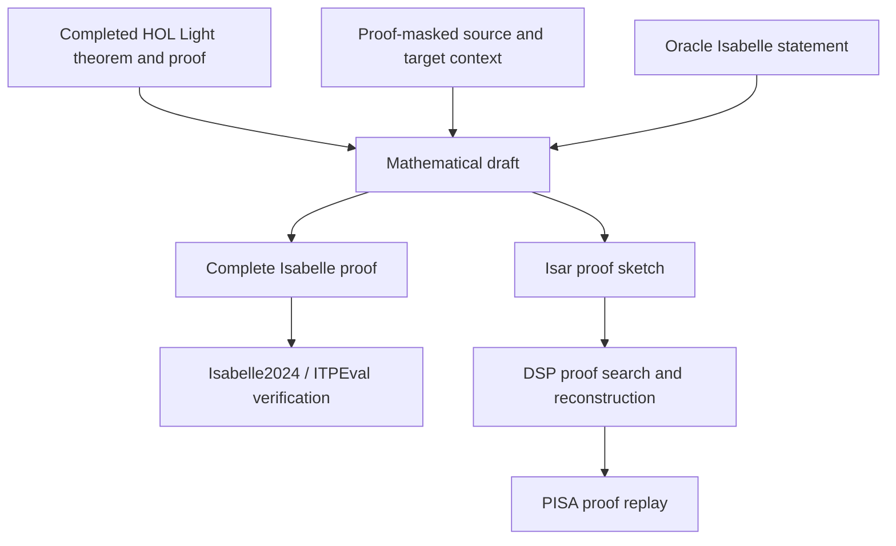

# Cross-Prover Proof Translation

**Transferring mathematical reasoning between formal proof languages with LLMs.**

This project extends [ITPEval](https://github.com/lean-dojo/ITPEval) with
theorem-level proof-transfer experiments. It extracts a completed source proof,
turns its reasoning into a mathematical draft, and uses that draft to guide
proof reconstruction in a different theorem prover.

The contributions below are the research pipelines and experiment infrastructure
added in this fork. The benchmark datasets, base toolchain manager, and original
prover integrations come from upstream ITPEval.

## Contributions

- **Theorem-level dataset preparation.** Extract individual declarations and
  proofs, pair source and target statements, and retain source spans, file hashes,
  alignment status, and coverage reports. A file can contribute multiple theorem
  pairs rather than one file-level example.
- **Proof-informed mathematical drafts.** Preserve the source proof's strategy
  and intermediate claims while using proof-masked reference files for definitions,
  notation, and helper statements. Completed target reference proofs are excluded
  from the generation inputs.
- **Two Isabelle reconstruction paths.** Reuse identical saved drafts for complete
  proof generation with Isabelle2024/ITPEval, or structured Isar sketches followed
  by DSP proof search, reconstruction, and replay through PISA.
- **A source-proof ablation.** A separate Isabelle-to-Lean draft experiment supplies
  only the source statement and masked reference context, allowing comparison
  with drafts informed by the original proof.
- **Selectable inference and reproducible runs.** Choose API or local vLLM inference
  independently for Draft and Sketch. Save visible model content, provenance,
  token statistics, and failures; invalidate cached outputs when relevant inputs,
  prompts, model settings, or verification runtimes change.

## Experiments

All current experiments use an **oracle target statement**: the target-language
theorem declaration is supplied by the aligned dataset. The task is to reconstruct
its proof from source-language reasoning. Statement translation is a separate
research problem.

| Experiment | Direction | Dataset | Output and verification |
|---|---|---|---|
| V1 | Isabelle/HOL → Lean 4 | Babel Formal | Mathematical drafts and JSONL export for an external DSP+ Sketch pipeline |
| V2, ITPEval baseline | HOL Light → Isabelle/HOL | Babel Formal; Hundred Theorems | Complete candidate proofs checked with Isabelle2024 through ITPEval |
| V2, DSP baseline | HOL Light → Isabelle/HOL | Babel Formal; Hundred Theorems | Isar sketches, proof search, reconstructed proofs, and PISA replay |

The current V2 extraction yields **163 candidate pairs across 16 Babel Formal
topics** and **99 candidate pairs across 13 Hundred Theorems file groups**. These
are declaration-name matches, including helper lemmas; they require semantic
review before defining a final evaluation cohort. The latter count does not
represent 99 independently reviewed instances of the famous 100 theorems.

## How the V2 pipeline works



Each record represents one target theorem. Saved drafts provide a common input
to both baselines, while their generation contracts, verification artifacts, and
resume state remain separate. Dataset-specific frontends share the execution
engines, so adding a dataset does not require duplicating the prover adapter.

## Quick start

Use **Python 3.10** for the main pipeline environment and **Python 3.12** for
the separate vLLM server environment. The main environment covers data
collection/extraction, API generation, and Isabelle/DSP compilation and
verification orchestration. Formal prover installations are separate from pip
dependencies; the native DSP-style backend uses Isabelle2026.

```bash
git clone https://github.com/riverside234/itpeval-modify.git
cd itpeval-modify
python -m pip install -r requirements.txt
```

The two root requirements files are:

- `requirements.txt`: main Python 3.10 environment; installs the project and
  its dependencies from `pyproject.toml`.
- `requirements-vllm.txt`: isolated Python 3.12 Linux/CUDA server; includes
  vLLM, Transformers, and Hugging Face Hub.

On the lab machine, create each environment under the repository root:

```bash
cd /data/not_backed_up/yxu209/ITPEval
source vllm/env_vars.sh

# Main environment: data preparation, generation and proof verification.
conda create --prefix "$PWD/.venv" python=3.10 pip
conda activate "$PWD/.venv"
python -m pip install -r requirements.txt

# Separate server environment; vllm/environment.yml selects Python 3.12.
conda env create --prefix "$PWD/vllm/env" --file vllm/environment.yml
"$PWD/vllm/env/bin/python" -m pip install -r requirements-vllm.txt
"$PWD/vllm/env/bin/python" -m pip check
```

The main environment can remain active while `vllm/launch_qwen.sh` uses the
server interpreter explicitly. Both environment directories are Git-ignored.

Run commands from the repository root. Extract one Babel Formal theorem:

```bash
python -m eval.pipeline.hol_light_to_isabelle.babel_formal_pipeline.extract_hol_light \
  --topic circle_average \
  --target-key circleAverage_center_independent \
  --output eval/results/quickstart/records.jsonl
```

Preview its Draft prompt and inference settings without calling a model:

```bash
python -m eval.pipeline.hol_light_to_isabelle.babel_formal_pipeline.generate_draft \
  --input eval/results/quickstart/records.jsonl \
  --output eval/results/quickstart/drafts.jsonl \
  --dry-run
```

Remove `--dry-run` to generate the draft. For API inference, set `OPENAI_API_KEY`
in the shell environment or the ignored `eval/.env` file. The default configuration
uses GPT-5.6 Terra, with medium reasoning effort for Draft and high for Sketch.

After generating the draft and provisioning Isabelle2024, run complete-proof
generation and verification:

```bash
python -m eval.pipeline.hol_light_to_isabelle.babel_formal_pipeline.v2_itpeval.run \
  --drafts eval/results/quickstart/drafts.jsonl \
  --samples 1 \
  --sketch-output eval/results/quickstart/sketches.jsonl \
  --output eval/results/quickstart/verified.jsonl
```

The runner checks the target theory context before model generation. Add
`--dry-run` to preview its prompt without a native prover. For batch extraction,
replace the topic and target filters with `--all-topics --all-targets`.

Detailed commands, runtime configuration, and preflight checks:

- [Babel Formal: both V2 baselines](eval/pipeline/hol_light_to_isabelle/babel_formal_pipeline/README.md)
- [Hundred Theorems: extraction, coverage, and both baselines](eval/pipeline/hol_light_to_isabelle/hundred_theorems_pipeline/README.md)
- [Dataset organization and pipeline entry points](eval/pipeline/hol_light_to_isabelle/README.md)

## API and local inference

The V2 Draft and Sketch stages can use different inference backends while
retaining the same prompt and record contracts.

| Backend | Configuration | Setup |
|---|---|---|
| GPT API | [API profile](eval/configs/inference/api.example.json), or the default settings | Pipeline Python environment and API credentials |
| Qwen via vLLM | [Qwen profile](eval/configs/inference/qwen_vllm.example.json) | Isolated server environment, pinned checkpoint, and runtime manifest |

Select a profile with `--llm-config` on a standalone generator, or
`--sketch-llm-config` on a saved-Draft runner. The local profile is configured for
`Qwen/Qwen3.8-27B`. See [vLLM setup and run commands](vllm/README.md) for environment
creation, model download, server preflight, and prompt-length checks.

The client stores final visible content and excludes reasoning text, raw API
responses, and prompt text from saved generation records. Local requests check
the server identity and token budget before generation. Default output directories
separate API, Qwen, and mixed-stage experiments.

## Evaluation and validation

Results preserve the requested theorem and sample denominator, including failed
drafts, missing samples, and context failures. JSON summaries report failure
categories and empirical success among the requested `K` proof samples. Resume
checks include the source context, draft, target statement, model configuration,
and verifier settings.

Verification establishes the selected theorem **relative to the supplied
background**. Earlier masked helper lemmas remain admitted background facts;
the selected target and generated intermediate claims must be proved. In the
DSP path, successful search must produce concrete methods that pass a fresh
replay before the result counts as verified.

Run the regression suite without API credentials, a GPU, or native provers:

```bash
python -m unittest discover -s tests/hol_light_to_isabelle -p 'test_*.py'
```

The suite covers extraction, masking, context preservation, cache invalidation,
failure accounting, model-output handling, and DSP reconstruction and replay.
Model and DSP transport tests use explicit fakes. Native Isabelle/PISA
compatibility, GPU deployment, and proof success rates require separate lab
runs; software regression results do not measure proof-transfer performance.

## Contribution map

```text
eval/pipeline/
├── proof_transfer/                 # V1: Isabelle → Lean drafts and DSP+ export
├── statement_only_control/         # V1: source statement/reference ablation
├── hol_light_to_isabelle/
│   ├── babel_formal_pipeline/       # V2: Babel extraction, prompts, and runners
│   │   ├── v2_itpeval/             # Complete-proof generation and verification
│   │   └── v2_dsp/                 # DSP adapter, proof search, and replay
│   └── hundred_theorems_pipeline/  # V2: dataset frontend using shared engines
└── inference/                      # Shared API/vLLM configuration and client

eval/configs/                       # Example inference and DSP runtime profiles
tests/hol_light_to_isabelle/         # Pipeline and adapter regression coverage
vllm/                               # Isolated model-serving setup and diagnostics
```

## Attribution and license

This fork builds on [ITPEval](https://github.com/lean-dojo/ITPEval) and uses its
aligned benchmark material. The Isabelle DSP adapter adapts the search order
from [Draft, Sketch, and Prove](https://github.com/albertqjiang/draft_sketch_prove);
its upstream [license and notices](eval/pipeline/hol_light_to_isabelle/babel_formal_pipeline/v2_dsp/UPSTREAM_LICENSE.txt)
are retained. These upstream contributions are credited separately from this
fork's extraction, prompting, orchestration, and inference extensions.

See [LICENSE](LICENSE) for the repository's MIT license and
[third-party dataset notices](data/third_party_licenses/README.md) for the terms
applicable to benchmark and library files.
